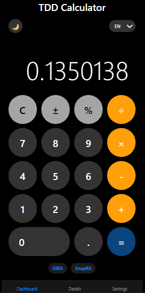

# Fortifying Your Code with TDD and Unit Testing Using .NET Core

Project developed during the Quality Assurance (QA) Experience Bootcamp under the guidance of specialist [Mauro Correia Junior](https://www.linkedin.com/ "Mauro Correia Junior")

Explore the full potential of unit testing and discover how it can help you build increasingly robust and efficient solutions. Test coverage can be a powerful ally in taking the quality of your applications to the next level. You are challenged to create your own project and set your own test coverage goal (e.g., 80%).

## Challenge Description

- **Part 1: Creating a new project**
  - Setting up test projects and adding code references
- **Part 2: Creating calculator functions**
  - Creating the first function test – addition
  - Implementing other basic calculator functions
  - Developing an operation history feature
- **Part 3: Coding business rules**
  - Restricting operations to integers and two parameters.
  - Forcing the history stack to strictly return only the last 3 executed records.

## Applied Business Rules

- **Data types:** Integer numbers only.
- **Parameters:** Exactly 2 parameters per math operation.
- **History limit:** The lookup structure always shifts to return the last 3 operations.

## Structure

- 📁 NewTalent
  - 📁 Dependencies
    - 📄 Calculator.cs
    - 📄 Program.cs
  - 📄 NewTalent.csproj
- 📁 TestNewTalent
  - 📁 Dependencies
    - 📄 UnitTest.cs
  - 📄 TestNewTalent.csproj
- 📄 .gitignore
- 📄 LICENSE
- 📄 README.md

## How to Run Tests

Ensure you have the .NET Core SDK installed, navigate to the root directory, and trigger:

```bash
dotnet test
```



[LICENSE](/LICENSE)
